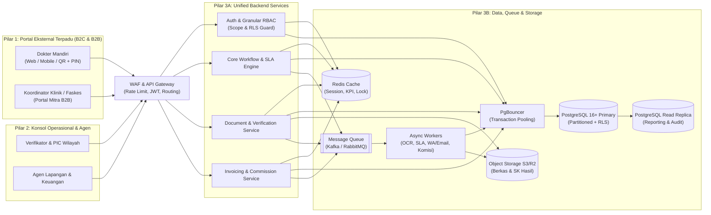

# ARCHITECTURE.md — Arsitektur Sistem & Infrastruktur Skala Nasional MedCred

Dokumen ini menjelaskan cetak biru arsitektur teknis (*High-Level & Component Architecture*) untuk platform **MedCred Nasional**—sistem perantara fasilitasi administrasi dan pemberkasan tenaga medis ke instansi pemerintah (Kemenkes SatuSehat SDMK, KKI, Kolegium, dan Dinas Kesehatan) yang dirancang untuk menampung puluhan hingga ratusan juta baris data dengan latensi milidetik.

## 1. Paradigma Arsitektur 3 Pilar (*3-Pillar Architecture*)

Untuk menjaga keseimbangan antara pengalaman pengguna yang ringkas, keamanan operasional internal yang ketat, dan konsistensi data nasional, arsitektur **MedCred Nasional** dipisahkan menjadi **3 pilar utama**:

1. **Pilar 1 — Portal Pengguna Eksternal Terpadu (B2C & B2B Portal)**:
   - Menggabungkan alur **Dokter Mandiri (B2C) + Portal Unggah QR/PIN** serta **Portal Mitra Klinik/Faskes/Organisasi (B2B)** dalam satu aplikasi/platform eksternal.
   - Meskipun berada dalam satu platform, alur antarmuka dan rute dibedakan secara dinamis berdasarkan konteks pengguna (`SELF_DOCTOR` / `QR_PIN` vs. `B2B_ADMIN` dengan `scope_org_id`), dengan isolasi data yang ditegakkan hingga lapisan database (*Row-Level Security*).
2. **Pilar 2 — Konsol Operasional Internal & Agen (*Internal Ops & Agent Console*)**:
   - Dipisahkan menjadi aplikasi/konsol terpisah yang didedikasikan khusus bagi tim internal dan jaringan mitra lapangan (`NATIONAL_VERIFIER`, `REGIONAL_PIC`, `FIELD_AGENT`, `FINANCE_OPS`, dan `SUPER_ADMIN`).
   - Dirancang sebagai ruang kerja berdensitas tinggi (*operational workbench*) untuk mengelola antrean tiket nasional, pemantauan SLA bertingkat, kurasi/verifikasi dokumen PSV, pengajuan ke instansi, penagihan, serta pencairan komisi.
3. **Pilar 3 — Layanan Backend & Basis Data Terpusat (*Unified Core Backend & Data Layer*)**:
   - Berfungsi sebagai pusat kebenaran data (*single source of truth*) dan penegakan seluruh aturan bisnis (*state machine* tiket, perhitungan SLA otomatis, autentikasi, granular RBAC + *scope*, pemrosesan asinkron, dan basis data PostgreSQL 16+ terpartisi).

---

## 2. Visualisasi Arsitektur Sistem (*Diagrams & Blueprints*)

### A. Ilustrasi Arsitektur Terpadu 3 Pilar (*System Flow & Technical Overview*)

> *Catatan Aset Visual: Simpan diagram/ilustrasi arsitektur terpadu 3 pilar ini sebagai `./assets/medcred_nasional_3_pillar_architecture.png` (dan animasi alurnya sebagai `./assets/medcred_nasional_architecture_flow.gif`).*

### B. Cetak Biru Arsitektur 3 Pilar & Aliran Trafik (Text Blueprint)

```text
┌─────────────────────────────────────┐    ┌─────────────────────────────────────┐
│   PILAR 1: PORTAL EKSTERNAL TERPADU │    │  PILAR 2: KONSOL OPERASIONAL & AGEN │
│        (B2C & B2B Platform)         │    │    (Internal & Field Agent App)     │
│                                     │    │                                     │
│ • Dokter Mandiri (B2C & QR/PIN)     │    │ • Verifikator Pusat & Kurator PSV   │
│ • Koordinator Klinik / Faskes (B2B) │    │ • Koordinator Wilayah (Regional PIC)│
│ • Pantau Progres & Unduh Hasil SK   │    │ • Agen Lapangan & Staf Keuangan     │
└──────────────────┬──────────────────┘    └──────────────────┬──────────────────┘
                   │ HTTPS / TLS 1.3                          │ HTTPS / TLS 1.3 + MFA
                   └────────────────────┬─────────────────────┘
                                        ▼
┌────────────────────────────────────────────────────────────────────────────────┐
│                        EDGE SECURITY & API GATEWAY                             │
│  • CDN & Web Application Firewall (WAF) — DDoS & Bot Protection                │
│  • API Gateway — Strict Rate Limiting (PIN QR & OTP), Route Guard, JWT Verify  │
└───────────────────────────────────────┬────────────────────────────────────────┘
                                        │
                                        ▼
┌────────────────────────────────────────────────────────────────────────────────┐
│              PILAR 3A: CORE BACKEND SERVICES (UNIFIED & STATELESS)             │
│                                                                                │
│  ┌───────────────────────────┐   ┌───────────────────────────┐                 │
│  │   Auth & RBAC Service     │   │  Core Workflow & Ticket   │                 │
│  │ • Multi-Login & MFA       │   │ • State Machine 7-Tahap   │                 │
│  │ • Scope & RLS Context     │   │ • QR Session & PIN Gen    │                 │
│  └─────────────┬─────────────┘   └─────────────┬─────────────┘                 │
│                │                               │                               │
│  ┌─────────────┴─────────────┐   ┌─────────────┴─────────────┐                 │
│  │   Document & OCR/PSV      │   │  Finance & Commission     │                 │
│  │ • Presigned URL S3/R2     │   │ • B2C/B2B Invoicing       │                 │
│  │ • SHA-256 & Metadata      │   │ • Agent & PIC Ledger      │                 │
│  └─────────────┬─────────────┘   └─────────────┬─────────────┘                 │
└────────────────┼───────────────────────────────┼───────────────────────────────┘
                 │                               │
        ┌────────┴────────┐             ┌────────┴────────┐
        ▼                 ▼             ▼                 ▼
┌──────────────┐   ┌─────────────────────────┐   ┌───────────────────────────────┐
│ Redis Cache  │   │     Message Queue /     │   │    Object Storage (S3 / R2)   │
│ • Session    │   │      Event Broker       │   │ • Berkas Persyaratan (PDF/JPG)│
│ • KPI TTL    │   │    (Kafka / RabbitMQ)   │   │ • Dokumen Hasil (SK/STR/SIP)  │
│ • RateLimit  │   └────────────┬────────────┘   └───────────────────────────────┘
└──────┬───────┘                │
       │                        ▼
       │           ┌─────────────────────────┐
       │           │   Async Job Workers     │
       │           │ • OCR & PSV Checker     │
       │           │ • SLA Watchdog (5-min)  │
       │           │ • WA / Email Gateway    │
       │           │ • Commission Calculator │
       │           └────────────┬────────────┘
       │                        │
       └───────────┬────────────┘
                   ▼
┌────────────────────────────────────────────────────────────────────────────────┐
│              PILAR 3B: DATA & PERSISTENCE LAYER (100M+ ROWS READY)             │
│                                                                                │
│   ┌────────────────────────────────────────────────────────────────────────┐   │
│   │               PgBouncer (Transaction Connection Pooling)               │   │
│   └────────────────────┬───────────────────────────────┬───────────────────┘   │
│                        │ Write & Transactional Read    │ Reporting & Analytics │
│                        ▼                               ▼                       │
│   ┌────────────────────────────────────┐  ┌────────────────────────────────┐   │
│   │      PostgreSQL 16+ Primary        │  │   PostgreSQL Read Replicas     │   │
│   │ • Range Partitioned (Quarterly)    │─►│ • Rekap Nasional & Ekspor CSV  │   │
│   │ • Row-Level Security (RLS)         │  │ • Audit Log & Histori SLA      │   │
│   │ • Covering, Partial, GIN & BRIN    │  └────────────────────────────────┘   │
│   └────────────────────────────────────┘                                       │
└────────────────────────────────────────────────────────────────────────────────┘
```

### C. Diagram Interaksi Komponen (*Mermaid Architecture Flow*)



---

## 3. Pembagian Lapisan & Tanggung Jawab Teknis

### Pilar 1: Portal Pengguna Eksternal Terpadu (B2C & B2B Platform)
* **Satu Aplikasi, Dua Mode Konteks**:
  * **Mode B2C & QR Mandiri**: Dioptimalkan untuk akses cepat dari ponsel menggunakan tautan terenkripsi dan 6-digit PIN tanpa alur pendaftaran rumit, memungkinkan dokter mengunggah 8 dokumen wajib, memantau status, serta mengunduh SK/STR/SIP terbitan instansi.
  * **Mode Mitra B2B**: Ditujukan bagi admin/koordinator klinik atau rumah sakit untuk mengelola afiliasi dokter praktik, memantau progres pengajuan kolektif, dan meninjau tagihan organisasi.
* **Keamanan Isolasi**: Meskipun berbagi aplikasi *frontend*, setiap permintaan API wajib membawa konteks `scope_type` (`SELF_DOCTOR` atau `ORGANIZATION`) yang divalidasi oleh RBAC *backend* dan *Row-Level Security* (RLS) PostgreSQL.

### Pilar 2: Konsol Operasional Internal & Agen (*Internal Ops & Agent Console*)
* **Deployment & Domain Terpisah**: Ditempatkan pada subdomain dan jalur deployment tersendiri (misalnya `ops.medcred.id`) dengan kebijakan keamanan tambahan seperti wajib **MFA (TOTP/OTP)**, *session timeout* ketat, dan pembatasan IP bila diperlukan.
* **Ruang Kerja Berbasis Peran**:
  * **Verifikator Pusat (`NATIONAL_VERIFIER`)**: Antrean kurasi dokumen, pemeriksaan PSV, permintaan revisi berkas, dan pencatatan nomor resi pengajuan ke Kemenkes/KKI/Dinkes.
  * **Koordinator Wilayah (`REGIONAL_PIC`)**: Pemantauan antrean dan eskalasi SLA khusus wilayah provinsi yang ditugaskan (`scope_province_code`).
  * **Agen Lapangan (`FIELD_AGENT`)**: Pendaftaran dokter/klinik baru serta pemantauan riwayat dan status pencairan komisi.
  * **Keuangan (`FINANCE_OPS`)**: Rekonsiliasi pembayaran invoice B2C/B2B dan persetujuan *batch payout* komisi agen.

### Pilar 3: Layanan Backend & Basis Data Terpusat (*Unified Core Backend & Data Layer*)
1. **Edge Security & API Gateway**:
   * **WAF & DDoS Protection**: Menyaring trafik berbahaya sebelum menyentuh server aplikasi.
   * **Rate Limiter (Berbasis Redis)**: Membatasi percobaan PIN QR (maksimal 5 kali salah sebelum penguncian 30 menit), pengiriman WhatsApp OTP, dan laju unggahan berkas.
2. **Core Backend Services (Stateless)**:
   * **Auth & RBAC Service**: Mengelola autentikasi multi-kanal (`LOCAL_EMAIL`, `WHATSAPP_OTP`, `SATUSEHAT_SSO`, `GOOGLE_SSO`, `QR_PIN`), rotasi *refresh token*, dan evaluasi izin granular (`roles` + `permissions`).
   * **Core Workflow & Ticket Engine**: Menjalankan *state machine* 7 tahap pada `service_tickets`, menerbitkan sesi QR, dan mencatat jejak audit ke `ticket_stage_histories`.
   * **Document & Verification Service**: Menerbitkan *Presigned Upload/Download URL* (masa berlaku 15 menit) ke Object Storage, memverifikasi integritas file (`SHA-256`), dan menyimpan hasil ekstraksi OCR (`JSONB`).
   * **Finance & Commission Service**: Mengelola tagihan satuan (B2C) maupun konsolidasi (B2B) serta pencatatan hak komisi ke `commission_ledger`.
3. **Asynchronous Workers & Event Broker**:
   * **OCR & Metadata Worker**: Mengekstrak nomor STR, NIK, atau tanggal masa berlaku dokumen secara asinkron setelah unggahan selesai.
   * **SLA Watchdog Worker**: Mengevaluasi tabel `ticket_stage_slas` setiap 5 menit menggunakan *partial index* (`WHERE completed_at IS NULL`) untuk menandai status `WARNING` atau `BREACHED` dan memicu eskalasi.
   * **Notification Dispatcher Worker**: Mengirimkan pengingat kelengkapan berkas, permintaan revisi, status pengajuan instansi, dan notifikasi dokumen terbit via WhatsApp Business API dan Email.
   * **Commission Settlement Worker**: Mencatat komisi secara idempoten saat tiket berstatus `COMPLETED` dan tagihan berstatus `PAID`.
4. **Data & Storage Layer (Skala 100 Juta+ Baris)**:
   * **PostgreSQL 16+ Primary & Read Replicas**: Menggunakan *declarative range partitioning* (kuartalan/tahunan + `DEFAULT PARTITION`), *covering indexes* (`INCLUDE`), *GIN trigram*, *BRIN index*, kunci primer **UUIDv7**, **PgBouncer** (*transaction pooling*), serta **Row-Level Security (RLS)**.
   * **Object Storage (S3 / Cloudflare R2 / MinIO)**: Menyimpan seluruh berkas fisik terenkripsi (*Server-Side Encryption*), sementara database hanya menyimpan `file_storage_key` dan `file_sha256`.

---

## 4. Alur Data Utama (*End-to-End Data Flows*)

### A. Alur Unggah Mandiri via Portal Eksternal (B2C / QR Code / B2B)

```text
Dokter / PIC Klinik ──► Pilar 1 (Portal Eksternal) ──► API Gateway + Redis Rate-Limit
       │
       ▼
Minta Presigned Upload URL ──► Backend verifikasi sesi QR / izin organisasi B2B
       │
       ▼
Upload File Langsung ke Object Storage (S3/R2) ──► Bebas beban bandwidth di API Server
       │
       ▼
Konfirmasi Upload ke Backend ──► Simpan metadata & SHA-256 ke doctor_documents
       │
       ├──► Trigger PostgreSQL otomatis perbarui verified_docs_count di service_tickets
       └──► Publish event ke Message Queue ──► Worker jalankan OCR & notifikasi PIC (Pilar 2)
```

### B. Alur Kurasi, Pengajuan Instansi & Penegakan SLA (Konsol Operasional)

```text
Verifikator / PIC (Pilar 2) ──► Ubah Status Tiket (misal: INTERNAL_CURATION -> SUBMITTED_TO_GOV)
       │
       ▼
Validasi Aturan State Machine (Cek kelengkapan dokumen wajib & nomor resi instansi)
       │
       ▼
Transaksi PostgreSQL (Pilar 3):
  1. UPDATE service_tickets.current_stage
  2. INSERT ticket_stage_histories (Audit Trail)
  3. Trigger trg_ticket_stage_sla otomatis menutup SLA lama & membuka SLA tahap baru
       │
       ▼
Publish Event ke Queue ──► Notification Worker kirim update progres ke Portal Eksternal (Pilar 1) & WA
```

---

## 5. Strategi Keamanan, Keandalan & Skalabilitas

1. **Pertahanan Berlapis (*Defense-in-Depth*)**:
   * **Transport**: HTTPS (TLS 1.3) wajib di seluruh jalur komunikasi antar-pilar.
   * **Aplikasi**: Pemisahan aplikasi antara Portal Eksternal (Pilar 1) dan Konsol Operasional (Pilar 2), dilengkapi RBAC granular (`roles` + `permissions`) serta pembatasan cakupan (`GLOBAL`, `PROVINCE`, `ORGANIZATION`, `SELF_DOCTOR`).
   * **Database**: *Row-Level Security* (RLS) menggunakan `SET LOCAL app.current_role`, `app.current_org_id`, dan `app.current_province` di setiap transaksi, serta enkripsi kolom AES-256 untuk NIK dan rekening bank.
2. **Idempotensi pada Operasi Kritis**:
   * Seluruh *webhook* pembayaran invoice, pengajuan ke instansi, dan pencatatan komisi di `commission_ledger` menggunakan *Idempotency Key* agar percobaan ulang (*retry*) dari antrean pesan tidak pernah menggandakan data finansial.
3. **Kesiapan Pertumbuhan Data Nasional**:
   * Penggunaan **UUIDv7** menjaga penyisipan indeks B-Tree selalu berurutan (*append-only*) sehingga latensi tulis tetap stabil di bawah 5 ms meskipun tabel telah melewati ratusan juta baris.
   * Kueri pelaporan berat dan ekspor CSV dialihkan sepenuhnya ke **PostgreSQL Read Replica** agar tidak mengganggu performa transaksi operasional harian.