# MedCred Nasional — Platform Fasilitasi Administrasi & Pemberkasan Dokter Indonesia

**MedCred Nasional** adalah platform *hybrid* (**B2C** Dokter Mandiri & **B2B** Mitra Klinik/Faskes/Komunitas) untuk layanan perantara administrasi, kurasi kelengkapan berkas, dan pemantauan pengurusan perizinan tenaga medis ke instansi terkait di seluruh Indonesia (**Kementerian Kesehatan / SatuSehat SDMK, Konsil Kedokteran Indonesia / KKI, Kolegium Profesi, dan Dinas Kesehatan / PTSP**).

---

## 1. Gambaran Umum & Fitur Utama

### A. Jalur Layanan Hibrida (B2C & B2B)
1. **Dokter Mandiri Perorangan (B2C)**:
   - Dokter mendaftar mandiri atau menerima tautan/QR Code unik untuk mengunggah persyaratan pengurusan (STR Seumur Hidup, SIP Praktik, SKP & Rekredensialing 5 Tahunan, atau Kenaikan Jenjang Fungsional).
   - Pemantauan progres berkas *real-time* dari ponsel hingga dokumen resmi terbit.
2. **Mitra Klinik / Faskes / Grup Dokter (B2B)**:
   - Koordinator faskes mengelola seluruh dokter dalam organisasinya pada satu dashboard terisolasi (*tenant isolation*).
   - Pengajuan kolektif (*batch*), pemantauan masa berlaku STR/SIP seluruh dokter, dan penagihan terpusat.

### B. Portal Unggah Mandiri via QR Code & PIN
- Setiap tiket pengurusan menghasilkan **tautan unik ter-hash** dan **6-digit PIN** yang dikirimkan otomatis melalui WhatsApp/Email.
- Dokter di daerah mana pun cukup memindai QR Code dari ponsel untuk melengkapi 8 dokumen standar tanpa perlu mengirim berkas fisik.

### C. Konsol Operasional Nasional, SLA & Jaringan Agen
- **Workflow Pipeline 7 Tahap**: `AWAITING_DOCS` → `INTERNAL_CURATION` → `REVISION_REQUIRED` → `SUBMITTED_TO_GOV` → `GOV_VERIFICATION` → `COMPLETED` / `CANCELLED`.
- **SLA Bertingkat Otomatis**: Target durasi per tahapan yang dikontrol langsung oleh *database trigger* PostgreSQL.
- **Manajemen Agen Lapangan & Komisi**: Mendukung struktur agen akuisisi, koordinator provinsi, dan PIC internal beserta perhitungan komisi otomatis saat tiket selesai.

---

## 2. Arsitektur Teknologi & Kinerja Skala 100 Juta+ Baris

| Lapisan | Teknologi & Strategi Optimasi |
| :--- | :--- |
| **Database Utama** | **PostgreSQL 16+** dengan *Declarative Range Partitioning* (kuartalan & tahunan) + `DEFAULT PARTITION` |
| **Strategi Indexing** | *Covering Indexes* (`INCLUDE`) untuk *Index-Only Scan* (<5 ms), *Partial Indexes* untuk antrean aktif, *GIN Trigram* (`pg_trgm`) untuk pencarian nama/STR, dan *BRIN Index* untuk log audit |
| **Keamanan & Isolasi** | **Row-Level Security (RLS)** untuk isolasi data B2B & wilayah provinsi, enkripsi kolom **AES-256** (`pgcrypto`) untuk NIK & rekening bank, serta **SHA-256** lookup hash |
| **Connection Pooling** | **PgBouncer** (mode *Transaction Pooling*) di depan PostgreSQL |
| **Object Storage** | **AWS S3 / MinIO / Cloudflare R2** (berkas PDF/JPG tidak disimpan sebagai BLOB di database; diakses melalui *Presigned URL* berdurasi 15 menit) |
| **Frontend Console** | Single-Page Console ringan berbasis CSS murni & Vanilla JS (bebas *lag* / ANR di perangkat seluler maupun desktop) |

---

## 3. Struktur Skema Database Lengkap (28 Tabel / 6 Modul)

Skema database (`medcred_nasional_schema_v3.sql`) dirancang untuk menampung ratusan juta baris transaksi dengan waktu respons hitungan milidetik:

### Modul 1: Master Data Referensi
1. `master_specialties` — Daftar spesialisasi kedokteran & nama kolegium pengampu.
2. `master_service_types` — Jenis layanan pengurusan, instansi tujuan (`KEMENKES_SDMK`, `KKI`, `DINKES_PTSP`, `KOLEGIUM`), SLA default, dan daftar kode dokumen wajib (`JSONB`).

### Modul 2: Identitas Pengguna, Authentication & Multi-Tenant B2B
3. `users` — Akun pengguna inti (menggunakan **UUIDv7** berurutan waktu untuk mencegah fragmentasi indeks).
4. `organizations` — Data klinik, rumah sakit, atau asosiasi dokter mitra B2B beserta kode wilayah provinsi/kota.
5. `user_auth_identities` — Kanal login multi-metode (`LOCAL_EMAIL`, `WHATSAPP_OTP`, `SATUSEHAT_SSO`, `GOOGLE_SSO`, `QR_PIN`).
6. `user_mfa_methods` — Konfigurasi autentikasi dua faktor (`TOTP_APP`, `WHATSAPP_OTP`, `EMAIL_OTP`).
7. `user_sessions` *(Partitioned)* — Manajemen *refresh token* dan pencabutan sesi perangkat secara instan.

### Modul 3: Granular RBAC & Cakupan Wilayah/Organisasi
8. `roles` — Master peran (`SUPER_ADMIN`, `NATIONAL_VERIFIER`, `REGIONAL_PIC`, `B2B_ADMIN`, `DOCTOR`, `FIELD_AGENT`, `FINANCE_OPS`).
9. `permissions` — Master izin aksi granular per modul (misal: `tickets:submit_gov`, `docs:verify_psv`, `commissions:approve_payout`).
10. `role_permissions` — Matriks relasi M:N antara peran dan izin.
11. `user_role_assignments` — Penugasan peran yang diikat ke ruang lingkup (`GLOBAL`, `PROVINCE`, `ORGANIZATION`, `SELF_DOCTOR`) dan masa berlaku.

### Modul 4: Agen Lapangan, Profil Dokter & Repositori Legalitas
12. `agents_and_pics` — Data agen akuisisi, koordinator wilayah, dan operator internal beserta rekening terenkripsi.
13. `doctors` — Profil dokter nasional dengan NIK terenkripsi (`nik_encrypted`), `nik_hash` untuk pencarian eksak, dan nomor STR unik.
14. `doctor_organization_affiliations` — Relasi N:N tempat praktik dokter (maksimal 3 slot SIP sesuai regulasi).
15. `doctor_licenses` — Catatan izin aktif (`STR`, `SIP_1`, `SIP_2`, `SIP_3`, `SERKOM`) beserta *partial index* pemantauan kedaluwarsa 5 tahunan.
16. `doctor_documents` *(Partitioned)* — Metadata berkas unggahan dokter di Object Storage, hasil ekstraksi OCR (`JSONB`), dan status verifikasi PSV.

### Modul 5: Tiket Pengurusan, Sesi QR, SLA & Output Instansi
17. `service_tickets` *(Partitioned Kuartalan)* — Tabel transaksi utama pengurusan berkas dengan *denormalized counter* (`verified_docs_count`) yang diperbarui otomatis oleh *trigger*.
18. `qr_upload_sessions` — Sesi tautan dan PIN portal mandiri dokter/mitra beserta masa kedaluwarsa.
19. `ticket_stage_histories` *(Partitioned + BRIN)* — Jejak audit perpindahan status dan payload respons instansi.
20. `auth_audit_logs` *(Partitioned + BRIN)* — Log keamanan login, perubahan hak akses, dan akses data sensitif NIK.
21. `issued_outcomes` — Repositori dokumen hasil resmi yang diterbitkan oleh Kemenkes/KKI/Dinkes untuk diunduh dokter/klinik.
22. `notification_logs` *(Partitioned + BRIN)* — Riwayat pengiriman pengingat WhatsApp, Email, dan notifikasi sistem.
23. `service_sla_tiers` — Matriks target durasi jam per layanan, jalur B2C/B2B, prioritas, dan tahapan.
24. `ticket_stage_slas` *(Partitioned)* — Pelacakan SLA aktif per tiket yang otomatis dibuka/ditutup oleh *trigger* `trg_ticket_stage_sla`.

### Modul 6: Penagihan (Invoicing) & Buku Besar Komisi Agen
25. `service_invoices` — Tagihan layanan perantara untuk dokter mandiri (B2C) maupun penagihan kolektif mitra klinik (B2B).
26. `invoice_items` — Rincian item tiket per tagihan.
27. `commission_rules` — Aturan perhitungan komisi (nominal tetap atau persentase) untuk `REFERRAL_AGENT`, `HANDLING_PIC`, dan `REGIONAL_LEAD`.
28. `commission_ledger` *(Partitioned)* — Buku besar pencatatan hak komisi bruto, potongan PPh, nominal bersih, dan status pencairan (*payout*).

---

## 4. Diagram Relasi Antar Tabel (ERD)

```mermaid
erDiagram
    %% ==========================================
    %% 1. AUTHENTICATION, RBAC & MULTI-TENANT
    %% ==========================================
    users ||--o{ user_auth_identities : "1:N kanal login"
    users ||--o{ user_mfa_methods : "1:N metode MFA"
    users ||--o{ user_sessions : "1:N sesi aktif"
    users ||--o{ user_role_assignments : "1:N penugasan peran"
    users ||--o{ auth_audit_logs : "1:N log keamanan"

    roles ||--o{ role_permissions : "1:N"
    permissions ||--o{ role_permissions : "1:N"
    roles ||--o{ user_role_assignments : "1:N"
    organizations ||--o{ user_role_assignments : "1:N cakupan B2B"

    %% ==========================================
    %% 2. B2B ORGANIZATIONS & FIELD AGENTS
    %% ==========================================
    users ||--o| agents_and_pics : "1:1 profil agen/PIC"
    agents_and_pics ||--o{ agents_and_pics : "1:N koordinator wilayah"
    users ||--o{ organizations : "1:N PIC faskes"

    %% ==========================================
    %% 3. DOCTOR PROFILES & REPOSITORIES
    %% ==========================================
    users ||--o| doctors : "1:1 akun dokter"
    agents_and_pics ||--o{ doctors : "1:N akuisisi agen"
    master_specialties ||--o{ doctors : "1:N spesialisasi"

    doctors ||--o{ doctor_organization_affiliations : "1:N (maks 3 praktik)"
    organizations ||--o{ doctor_organization_affiliations : "1:N dokter mitra"

    doctors ||--o{ doctor_licenses : "1:N STR/SIP aktif"
    organizations ||--o{ doctor_licenses : "1:N lokasi SIP"
    doctors ||--o{ doctor_documents : "1:N dokumen syarat"

    %% ==========================================
    %% 4. CORE SERVICE TICKETS, QR & SLA
    %% ==========================================
    doctors ||--o{ service_tickets : "1:N permohonan"
    organizations ||--o{ service_tickets : "1:N batch B2B"
    master_service_types ||--o{ service_tickets : "1:N jenis layanan"
    agents_and_pics ||--o{ service_tickets : "1:N PIC & agen"

    service_tickets ||--o{ qr_upload_sessions : "1:N sesi QR"
    service_tickets ||--o{ ticket_stage_histories : "1:N riwayat status"
    service_tickets ||--o{ ticket_stage_slas : "1:N SLA tahapan"
    service_tickets ||--o{ issued_outcomes : "1:N hasil instansi"
    service_tickets ||--o{ notification_logs : "1:N log notifikasi"

    master_service_types ||--o{ service_sla_tiers : "1:N aturan SLA"

    %% ==========================================
    %% 5. INVOICING & AGENT COMMISSIONS
    %% ==========================================
    doctors ||--o{ service_invoices : "1:N tagihan B2C"
    organizations ||--o{ service_invoices : "1:N tagihan B2B"
    service_invoices ||--o{ invoice_items : "1:N rincian"
    service_tickets ||--o{ invoice_items : "1:N item tagihan"

    master_service_types ||--o{ commission_rules : "1:N skema komisi"
    agents_and_pics ||--o{ commission_ledger : "1:N hak komisi"
    service_tickets ||--o{ commission_ledger : "1:N sumber tiket"
    service_invoices ||--o{ commission_ledger : "1:N dasar settlement"
```



---

## 5. Panduan Instalasi & Pemeliharaan Database

1. **Inisialisasi Skema**:
   ```bash
   psql -U postgres -d medcred_nasional -f medcred_nasional_schema_v3.sql
   ```
2. **Konfigurasi Variabel Sesi untuk Row-Level Security (RLS)** pada setiap transaksi API backend:
   ```sql
   BEGIN;
   SET LOCAL app.current_role = 'B2B_ADMIN';
   SET LOCAL app.current_org_id = '0193a5b0-7c12-7000-8000-000000000001';
   SELECT * FROM service_tickets WHERE current_stage = 'AWAITING_DOCS';
   COMMIT;
   ```
3. **Otomatisasi Partisi Baru**:
   Gunakan ekstensi `pg_partman` atau *cronjob* bulanan untuk membuat partisi kuartal/tahun berikutnya minimal 3 bulan sebelum pergantian periode (meskipun `DEFAULT PARTITION` sudah disiapkan sebagai pengaman).